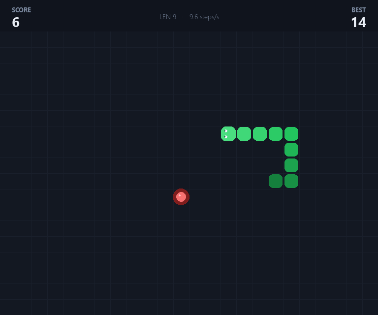

# Snake

A small desktop Snake game built with [pygame](https://www.pygame.org/) and managed with
[uv](https://docs.astral.sh/uv/).



## Run it

```bash
uv run main.py
```

`uv run` creates the virtual environment and installs `pygame` on first launch.

## Controls

| Key                     | Action                                  |
| ----------------------- | --------------------------------------- |
| Arrow keys / `W` `A` `S` `D` | Steer the snake                    |
| `Space` / `Enter`       | Start, pause, resume, or restart        |
| `P`                     | Pause / resume                          |
| `R`                     | Restart                                 |
| `Esc` / `Q`             | Quit                                    |

## How it plays

- Eat the red fruit to grow and score. The board speeds up from 7.5 to 18 steps per second
  as your score climbs.
- Turns are buffered (up to two per tick), so quick double taps still register while
  180° reversals are ignored.
- Hitting a wall or your own body ends the run. Fill the entire board to win.
- The header shows your score, the session best, snake length, and current speed.

## Project layout

```
main.py            entry point, window loop and key handling
snake/config.py    board size, speed curve, colour palette
snake/game.py      pure game rules (no pygame, fully unit-testable)
snake/renderer.py  pygame drawing: board, snake, food, overlays
tests/test_game.py rule tests
```

## Tests

```bash
uv run pytest
```

## Tweaking

Board dimensions, cell size, speed curve, and colours live in `snake/config.py`.
The rules in `snake/game.py` do not import pygame, so gameplay changes can be tested
without opening a window.
